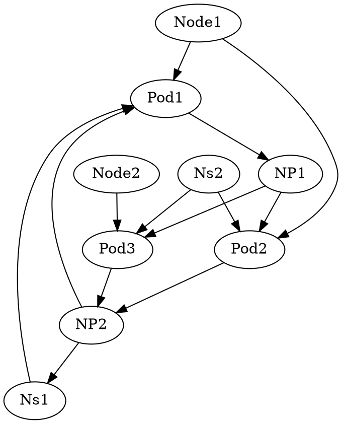

# Network Policy Graph

## Idea

Construct network policy test data by looking at the shape of the resource
relationship graph. 

Vertices in the resource graph:

* Node
* Pod
* Namespace
* Network Policy

## Example graph

* Some attributes 



## Generating

Starting parameters:

* P: number of pods
* PNS: Pods per Namespace 
* PNodes: Pods per Node
* NetPol: number of Network Policies

Construct initial graph of Pods, Namespace and Nodes. Then create network
policies with the following parameters:

* In degree: number of Pods selected by the policy.
* Out degree: number of Pods selected as policy targets.
* Ingress or Egress direction.

Policy types:

* SameNS -- In and Out are from the same namespace.
* CrossNSFocused -- Out selects <= 10 namespaces.
* CrossNSBroad -- Out selects > 10 namespaces.
* Global -- Out selects pods from all namespaces.

Out of the total NetPol, there will be a fractional amount of each kind for
a given graph.

Each of these number will be given a randomized distribution to create variants
for experimental purposes:

* ConstantDistn: constant distribution.
* UniformRange(start,end): ranges uniformly between \[start, end\]. This will be
  multinomal.
* Gaussian(mu, sigma): Gaussian with mu and sigma. Round to nearest for 
  integer parameters.

From the graph, labels can be generated to reflect the relationships by assigning
a unique label for each of the In and Out sets. 

We can assume a single port on each Pod for the time being.

## Collecting

The same graph above can be generated by listing all of the resources from a
live Kubernetes cluster.

## Tool

Source: `cmd/npgraph/main.go`

Command line:

### npgraph ui

* `-http <addr:port>`: address and port to bind to. Default to `:8080`

Run a web UI that allows for tweaking of the generation
parameters and generating the graph and associated K8s YAML. Shows the
graph respresentation of the resources.

### npgraph generate graph

Generate a graphviz encoded graph of configuration for the given
experimental parameters.

* `-seed` : random seed for generation.
* `-params <params.yaml>` : parameters used to generate graph

### npgraph generate k8s

* `-seed` : Random seed for generation.
* `-params <params.yaml>` : Parameters used to generate graph
* `-graph <file>` : Generate the resources from a graph file.

### npgraph generate params

Spit out a boilerplate JSON of the `params.yaml` for easy editing by the user.

### npgraph fetch

Save the resources in the cluster as a Graphviz graph with the appropriate
metadata in the comments.

* `-context`: cluster .kube context

## Implementation notes

Source: `cmd/npgraph/`. `make build` puts the binary in `bin/npgraph`.

**Graph metadata is in DOT attributes, not comments.** A comment is exactly what
every tool in a graphviz pipeline is entitled to discard, so a graph that had
been through `dot` would come back unreadable. Attributes survive it and
graphviz ignores the ones it does not know:

```dot
"pod-3" [kind="pod", namespace="ns-0", node="node-1"];
"np-0"  [kind="netpol", namespace="ns-0", direction="ingress", type="crossNSFocused"];
```

The attributes are optional on the way in. A hand-written graph -- the example
above, with a `kind` on each vertex -- places its pods by its edges, takes a
policy's namespace from its In set, and has its type inferred from the reach of
its Out set.

**Params are YAML** (`generate params` writes YAML; JSON is a subset of it and
also parses). Anything the file leaves out keeps its default, and an unknown key
is an error rather than a silently ignored one. Beyond the parameters above:

* `namespacePeerFraction`: the share of policies whose peers are whole
  namespaces (`namespaceSelector` with no `podSelector`) rather than individual
  pods. One peer standing for a thousand pods is very different work for a
  renderer than a thousand peers at the same out-degree.
* `focusedNamespaces` / `broadNamespaces`: how many namespaces the Out set of a
  CrossNSFocused and a CrossNSBroad policy spans. Both clamp to their side of
  the ten-namespace boundary, and to the number of namespaces that exist.

Every degree is clamped to what the graph can supply -- a policy cannot select
more pods than its namespace holds -- and the type mix is allocated by largest
remainder, so the counts are exact rather than binomially close.

**Labels.** Each policy gets two labels: `npgraph.io/in-<policy>` on the pods it
applies to, `npgraph.io/out-<policy>` on the pods it names as peers. Pod-level
peers are one peer per namespace (a peer ANDs its two selectors), except for a
Global policy, which collapses to a single peer with an empty
`namespaceSelector` -- "every namespace" is what the type means. Namespaces
carry `kubernetes.io/metadata.name`, which every namespaceSelector matches on.

**`fetch` shells out to `kubectl`** rather than linking client-go: three list
calls do not justify the dependency and the kubeconfig loading, and anyone with
a `-context` to pass already has kubectl. A policy declaring both policyTypes
becomes two vertices (`ns/name#ingress`, `ns/name#egress`), since a vertex
carries one direction. IPBlock peers are dropped -- the graph has no vertex for
an address.

**The UI** draws the graph itself, as four columns, rather than shelling out to
graphviz. It posts the params and seed back to `/generate`, and
`/download/graph.dot` and `/download/k8s.yaml` hand over the same bytes the
command line produces. Graphs past 600 vertices get their DOT and YAML but no
drawing.

