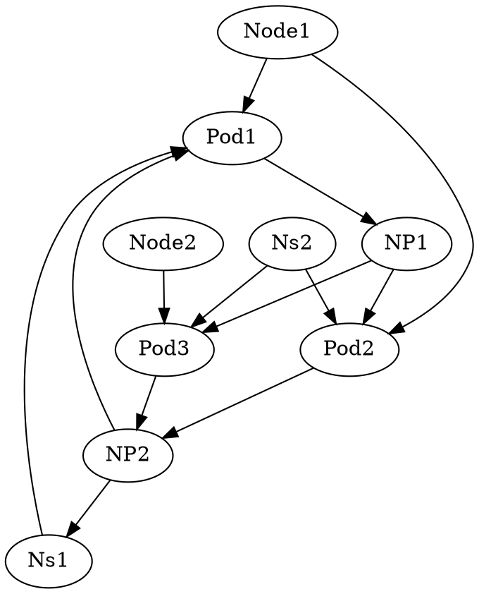

# Network Policy Graph

## Idea

Construct network policy test data by looking at the shape of the resource
relationship graph. 

Vertices in the resource graph:

* Node
* Pod
* Namespace
* Network Policy

## Example graph

* Some attributes 



The five edge kinds above are the whole vocabulary: `Node -> Pod` and
`Ns -> Pod` place a pod, `Pod -> NP` is the policy's In set, `NP -> Pod` is a
pod-level peer, and `NP -> Ns` is a peer standing for every pod of a namespace.
Anything else is rejected on the way in.

`npgraph` reads this graph as written, given a `kind` on each vertex (see
[Encoding](#encoding)); everything else is inferred. `NP1` is in `Ns1` because
that is where its In set lives, and it is a CrossNSFocused policy because its
Out set reaches `Ns2`.

## Generating

Starting parameters, with the name each one has in `params.yaml`:

* P (`pods`): number of pods
* PNS (`podsPerNamespace`): Pods per Namespace 
* PNodes (`podsPerNode`): Pods per Node
* NetPol (`policies`): number of Network Policies

Construct initial graph of Pods, Namespace and Nodes. Then create network
policies with the following parameters:

* In degree (`inDegree`): number of Pods selected by the policy.
* Out degree (`outDegree`): number of Pods selected as policy targets.
* Ingress or Egress direction (`ingressFraction`: the share that are ingress).

Policy types:

* SameNS -- In and Out are from the same namespace.
* CrossNSFocused -- Out selects <= 10 namespaces.
* CrossNSBroad -- Out selects > 10 namespaces.
* Global -- Out selects pods from all namespaces.

Out of the total NetPol, there will be a fractional amount of each kind for
a given graph (`mix`). The fractions are normalized against their sum and
allocated by largest remainder, so the counts come out exact rather than
binomially close: 100 policies at 0.05 global are 5 global policies, not
"about 5".

Each of these number will be given a randomized distribution to create variants
for experimental purposes:

* ConstantDistn: constant distribution.
  `{kind: constant, value: 30}`
* UniformRange(start,end): ranges uniformly between \[start, end\]. This will be
  multinomal.
  `{kind: uniform, start: 5, end: 20}`
* Gaussian(mu, sigma): Gaussian with mu and sigma. Round to nearest for 
  integer parameters.
  `{kind: gaussian, mu: 10, sigma: 3}`

A uniform integer draw is taken over the integers in \[start, end\] rather than
by rounding a continuous one, which would give the two endpoints half the weight
of every other value.

Three further parameters the shapes above need:

* `focusedNamespaces` / `broadNamespaces`: how many namespaces a CrossNSFocused
  and a CrossNSBroad policy's Out set spans. Each clamps to its own side of the
  ten-namespace boundary, and to the number of namespaces that exist -- a broad
  policy on a six-namespace cluster spans all six rather than failing.
* `namespacePeerFraction`: the share of policies whose peers are whole
  namespaces (`NP -> Ns`) rather than individual pods (`NP -> Pod`). One peer
  standing for a thousand pods is very different work for a renderer than a
  thousand peers at the same out-degree.

Every degree is clamped to what the graph can supply: a policy cannot select
more pods than its namespace holds, however large a number the distribution
names.

From the graph, labels can be generated to reflect the relationships by assigning
a unique label for each of the In and Out sets. Each policy gets two:
`npgraph.io/in-<policy>` on the pods it applies to, `npgraph.io/out-<policy>` on
the pods it names as peers. Namespaces carry `kubernetes.io/metadata.name`,
which is what every generated `namespaceSelector` matches on.

Pod-level peers are rendered one peer per namespace, since a peer ANDs its
`namespaceSelector` with its `podSelector`. A Global policy is the exception: it
collapses to a single peer with an empty `namespaceSelector`, because "every
namespace" is what the type means and a list of the namespaces that exist today
would say something weaker.

We can assume a single port on each Pod for the time being. Every generated pod
exposes TCP 8080, and every rule names that port.

## Encoding

The graph is written as DOT, and vertex metadata rides in DOT **attributes**
rather than in comments -- a comment is exactly what every tool in a graphviz
pipeline is entitled to discard, so a graph that had been through `dot` would
come back unreadable. Attributes survive it, and graphviz ignores the ones it
does not know:

```dot
digraph npgraph {
  "node-1" [kind="node"];
  "ns-0"   [kind="namespace"];
  "ns-1"   [kind="namespace"];
  "pod-3"  [kind="pod", namespace="ns-0", node="node-1"];
  "pod-9"  [kind="pod", namespace="ns-1", node="node-1"];
  "np-0"   [kind="netpol", namespace="ns-0", direction="ingress", type="crossNSFocused"];

  "node-1" -> "pod-3";
  "ns-0" -> "pod-3";
  "node-1" -> "pod-9";
  "ns-1" -> "pod-9";
  "pod-3" -> "np-0"; // In
  "np-0" -> "pod-9"; // Out
}
```

Only `kind` is required on the way in. A pod with no `namespace`/`node`
attribute is placed by its edges, a policy with no `namespace` takes it from its
In set, a policy with no `direction` is read as ingress, and a policy with no
`type` is classified by the reach of its Out set. This is what makes the
hand-written example above a valid input.

It is a parser for the subset of DOT this tool emits, not for the language:
subgraphs, edge chains (`a -> b -> c`) and default attribute statements are
rejected rather than half-understood, because a graph that came back missing its
relationships would generate a cluster with silently fewer policies.

## Collecting

The same graph above can be generated by listing all of the resources from a
live Kubernetes cluster. `npgraph fetch` resolves the cluster's selectors into
the graph's edges, so a collected graph and a generated one are the same kind of
object and feed the same renderer.

Vertex names are namespace-qualified (`prod/api`), since the graph has one flat
namespace of ids while a cluster has one per namespace and kind. A policy
declaring both policyTypes becomes two vertices (`prod/allow#ingress`,
`prod/allow#egress`), because a policy vertex carries one direction and the In
and Out sets of the two directions are independent.

Two things are dropped, both deliberately: an IPBlock peer, since the graph has
no vertex for an address, and a pod or policy whose namespace was not in the
listing, which is a race between two list calls rather than a broken cluster. An
unscheduled pod is kept and placed on a `<unscheduled>` node -- it is still a
policy subject, and dropping it would understate the In set.

## Tool

Source: `cmd/npgraph/`. `make build` puts the binary in `bin/npgraph`.

Command line. Generated output goes to stdout, diagnostics to stderr;
`npgraph help` prints the usage.

### npgraph ui

* `-http <addr:port>`: address and port to bind to. Default to `:8080`

Run a web UI that allows for tweaking of the generation
parameters and generating the graph and associated K8s YAML. Shows the
graph respresentation of the resources.

The params are a textarea posted back to `/generate`, and the graph is drawn
in-process as four columns -- nodes, namespaces, pods, policies -- rather than
by shelling out to graphviz, so the UI works on a machine that does not have it.
`/download/graph.dot` and `/download/k8s.yaml` hand over the same bytes the
command line produces for the same params and seed. A graph past 600 vertices
still gets its DOT and YAML, but no drawing: a picture of ten thousand pods is
not a picture of anything.

### npgraph generate graph

Generate a graphviz encoded graph of configuration for the given
experimental parameters.

* `-seed` : random seed for generation.
* `-params <params.yaml>` : parameters used to generate graph

Omitting `-params` generates from the defaults. The params and the seed are the
whole input: the same pair always produces the same graph, which is what lets an
experiment be quoted as two lines rather than by shipping the graph around.
Placement and policies are drawn from separate streams of the one seed, so
raising `podsPerNode` does not also reshuffle every policy.

### npgraph generate k8s

* `-seed` : Random seed for generation.
* `-params <params.yaml>` : Parameters used to generate graph
* `-graph <file>` : Generate the resources from a graph file.

`-graph` is mutually exclusive with `-seed` and `-params`: a graph file is the
whole input, and honoring the others alongside it would silently generate a
different cluster than the file names.

Writes Nodes, Namespaces, Pods and NetworkPolicies as a multi-document YAML
stream, in that order, so it can be applied top to bottom.

### npgraph generate params

Spit out a boilerplate JSON of the `params.yaml` for easy editing by the user.
It is written as YAML, of which JSON is a subset; both parse. The defaults,
shown here in flow style rather than the block style the command emits:

```yaml
pods: 1000
podsPerNamespace: {kind: uniform, start: 5, end: 20}
podsPerNode: {kind: constant, value: 30}
policies: 100
inDegree: {kind: uniform, start: 1, end: 10}
outDegree: {kind: gaussian, mu: 10, sigma: 3}
ingressFraction: 0.5
mix: {sameNS: 0.5, crossNSFocused: 0.3, crossNSBroad: 0.15, global: 0.05}
focusedNamespaces: {kind: uniform, start: 2, end: 10}
broadNamespaces: {kind: uniform, start: 11, end: 30}
namespacePeerFraction: 0.1
```

Anything a params file leaves out keeps its default, so a file can be cut down
to the parameters being varied. An unknown key is an error rather than a
silently ignored one: a typo that kept the default would produce a graph nobody
asked for, and no error to say so.

### npgraph fetch

Save the resources in the cluster as a Graphviz graph with the appropriate
metadata in the comments -- in attributes, per [Encoding](#encoding).

* `-context`: cluster .kube context

Lists through `kubectl` rather than linking client-go: three list calls do not
justify the dependency tree and the kubeconfig loading, and anyone with a
`-context` to pass already has kubectl on their machine. The output is sorted,
so two fetches of an unchanged cluster produce identical files.
