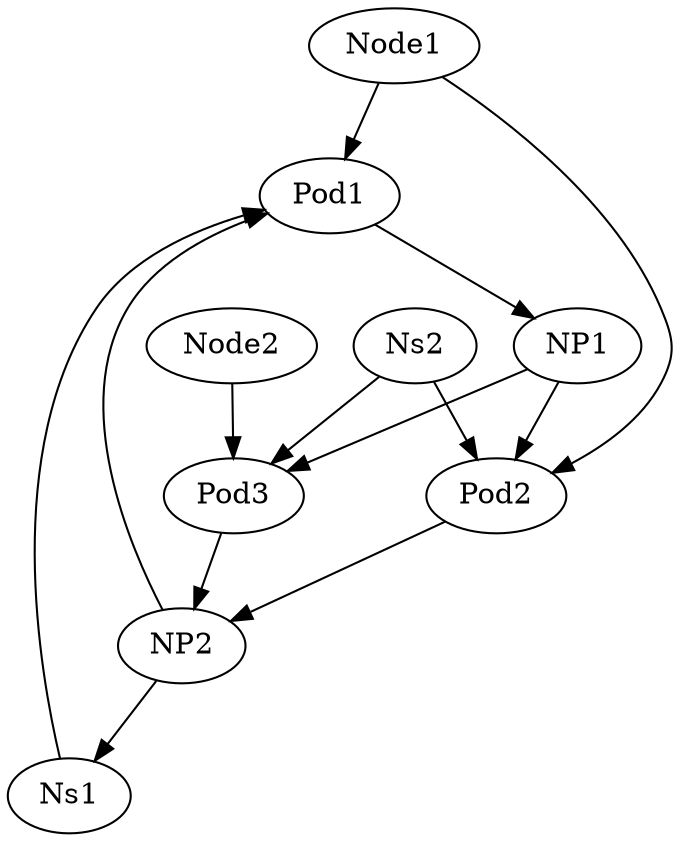

# Network Policy Graph

## Idea

Construct network policy test data by looking at the shape of the resource
relationship graph. 

Vertices in the resource graph:

* Node
* Pod
* Namespace
* Network Policy

## Example graph

* Some attributes 

## Generating

Starting parameters:

* P: number of pods
* PNS: Pods per Namespace 
* PNodes: Pods per Node
* NetPol: number of Network Policies

Construct initial graph of Pods, Namespace and Nodes. Then create network
policies with the following parameters:

* In degree: number of Pods selected by the policy.
* Out degree: number of Pods selected as policy targets.
* Ingress or Egress direction.

Policy types:

* SameNS -- In and Out are from the same namespace.
* CrossNSFocused -- Out selects <= 10 namespaces.
* CrossNSBroad -- Out selects > 10 namespaces.
* Global -- Out selects pods from all namespaces.

Out of the total NetPol, there will be a fractional amount of each kind for
a given graph.

Each of these number will be given a randomized distribution to create variants
for experimental purposes:

* ConstantDistn: constant distribution.
* UniformRange(start,end): ranges uniformly between \[start, end\]. This will be
  multinomal.
* Gaussian(mu, sigma): Gaussian with mu and sigma. Round to nearest for 
  integer parameters.

From the graph, labels can be generated to reflect the relationships by assigning
a unique label for each of the In and Out sets. 

We can assume a single port on each Pod for the time being.

## Collecting

The same graph above can be generated by listing all of the resources from a
live Kubernetes cluster.

## Tool

Source: `cmd/npgraph/main.go`

Command line:

### npgraph ui

* `-http <addr:port>`: address and port to bind to. Default to `:8080`

Run a web UI that allows for tweaking of the generation
parameters and generating the graph and associated K8s YAML. Shows the
graph respresentation of the resources.

### npgraph generate graph

Generate a graphviz encoded graph of configuration for the given
experimental parameters.

* `-seed` : random seed for generation.
* `-params <params.yaml>` : parameters used to generate graph

### npgraph generate k8s

* `-seed` : Random seed for generation.
* `-params <params.yaml>` : Parameters used to generate graph
* `-graph <file>` : Generate the resources from a graph file.

### npgraph generate params

Spit out a boilerplate JSON of the `params.yaml` for easy editing by the user.

### npgraph fetch

Save the resources in the cluster as a Graphviz graph with the appropriate
metadata in the comments.

* `-context`: cluster .kube context

