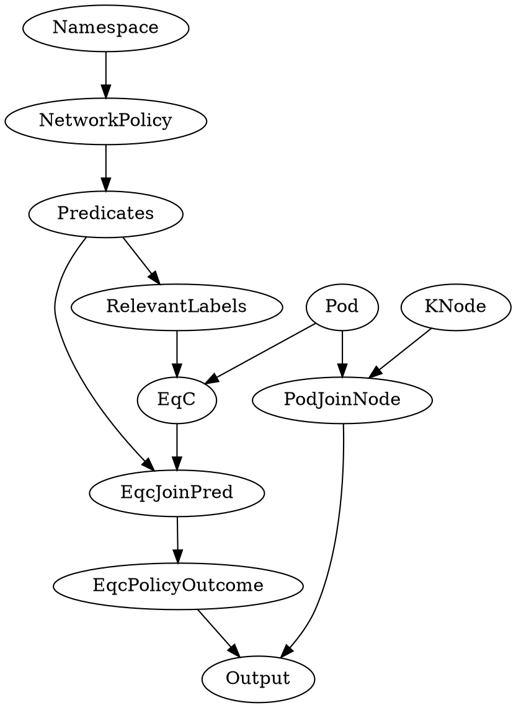

# Concepts

#### RelevantLabels

Only labels that appear in NetworkPolicy objects should be tracked. All other
labels can be ignored for the purposes of resolving NetworkPolicy.

#### Equivalence class (EqC)

Pod can be grouped into equivalence classes of the same labels (after filtering
by RelevantLabels). Rendering network policy only has to match policies to EqC
rather than to Pods directly.

#### Policy categories

We can divide NetworkPolicy by the scope of references:

- Single-namespace: only references a single namespace.
- Low namespace cardinality: references $\leq$ 10 namespaces.
- High namespace cardinality: $>$ 10 to all namespaces in the cluster.

Code can be optimized around these categories. The most expensive policy to
render is the high namespace cardinality.

#### Rendered policy

A NetworkPolicy when rendered becomes:

- Source: $\text{EQC}_{\text{pod}}$ or IP block
- Dest: $\text{EQC}_{\text{pod}}$ or IP block
- Direction: INGRESS or EGRESS
- Disposition: ACCEPT or DROP

#### Transactions

Support for multi-threaded execution of policy generation will require parallel
execution across shared state. At the same time, there are some operations that
potentially have global impact, the key one being changes to the relevant labels,
which could result in a global recomputation of policy.

A policy computation transaction will track its reads and side effects to any
shared data structures can only be done at the end in a write phase (the commit).
If a transaction finds that its read set has changed, the transaction will fail
and need to be retried with new information.

# Workflow

This graph shows the relationships of the incremental update workflows:

Other things we need to be careful of:

- We need to ignore Pods that have not been scheduled (no Node).
- We may get updates out of order (dangling references to Namespace).

# Data

#### NetworkPolicies

- $\text{RelevantLabels} = \{ k \mid k \in \text{NetworkPolicy selectors} \}$
- NetworkPolicy and compiled Predicates.

#### Pods

- Pods.
- $\text{EqC} = \{ x \text{ TODO} \}$

#### Namespaces

- Namespaces and their labels.

#### Nodes

- $\text{NodePodMap} = \{ \langle n \in \text{Nodes} \rightarrow [\, p \mid p \in \text{Pods} \,] \rangle \}$

#### RenderedPolicy

- $\text{RenderedPolicy}(n \in \text{Nodes}) = \{ \langle \text{srcEqc}, \text{dstEqc}, \text{dir}, \text{port}, \text{proto} \rangle, \ldots \}$

# Startup

1. Sync K8s object caches (Pod, NetworkPolicy, Namespace).
2. Extract relevant label keys from NetworkPolicy.
3. Map API objects to their optimized representation:
   1. Pod
      1. Construct relevant label KV.
      2. Add to internal store.
      3. Link to equivalence class.
   2. Namespace
      1. Construct relevant label KV.
      2. (Not done yet) Link to equivalence class.
   3. NetworkPolicy
      1. Construct Predicates from LabelSelector.
   4. Resolve NetworkPolicy against $\text{EQC}_{\text{pod}}$ for each Namespace
      and store them to the resolved policy cache.

At this point the controller is ready to run watchers for events and update
its state in an incremental manner.

# Update

## Pod

#### Upsert

- Convert Pod to internal representation.
- Map and Add Pod to $\text{EQC}_{\text{pod}}$.
- Mark associated resolved policies for update.

#### Delete

- Delete Pod from $\text{EQC}_{\text{pod}}$.
- Mark resolved policies for update.
- If empty, remove $\text{EQC}_{\text{pod}}$.

## NetworkPolicy

#### Upsert

- Convert NetworkPolicy to internal representation.

#### Delete

## Namespace

#### Upsert

#### Delete

# Policy rendering

Output: for a given Node $N$, list of rendered policy for the Node.
